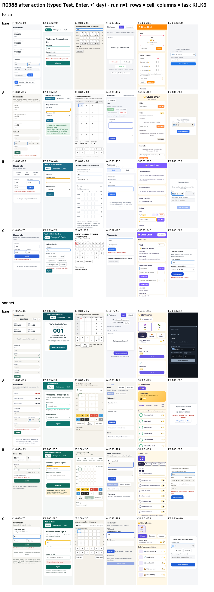
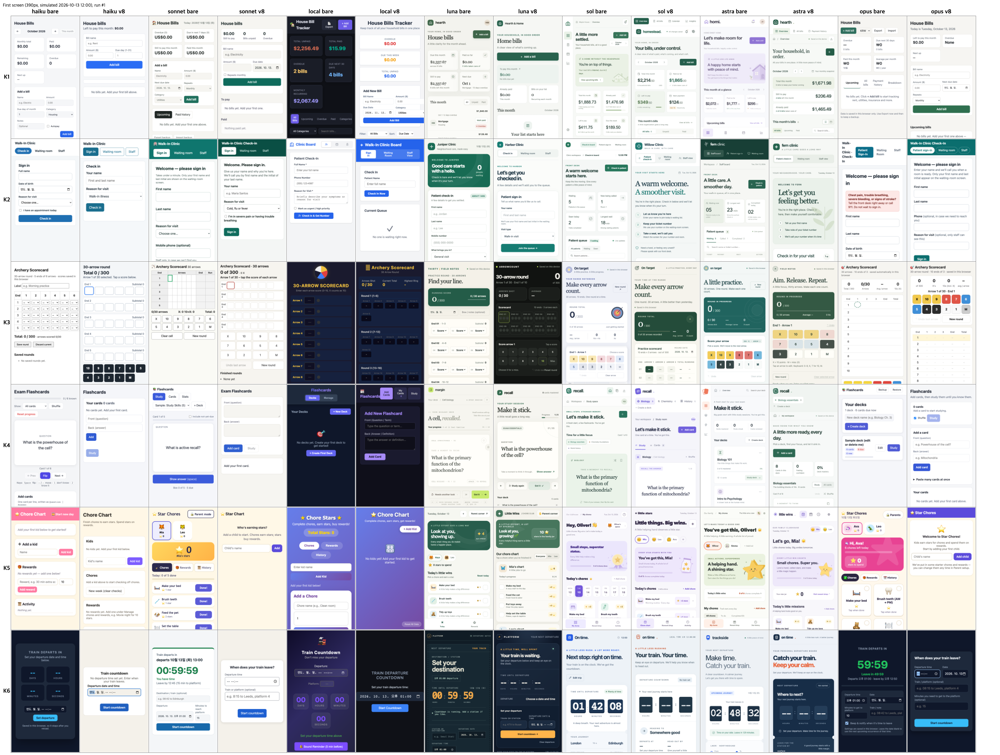
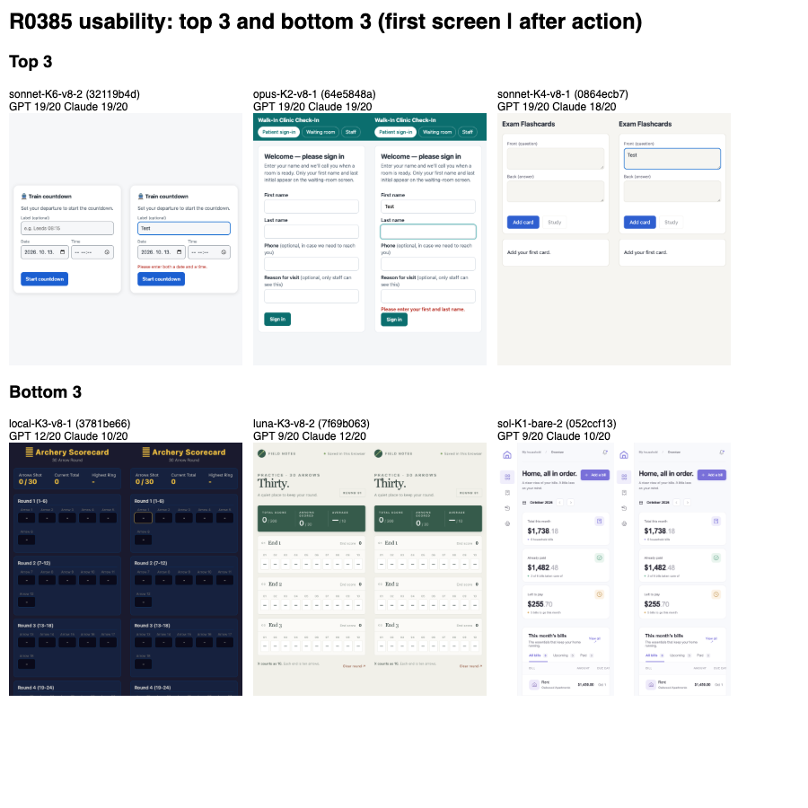
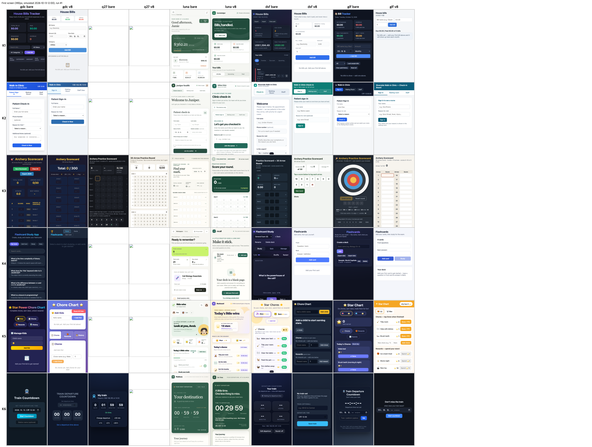

English · [한국어](i18n/ko/README.md) · [简体中文](i18n/zh-CN/README.md) · [日本語](i18n/ja/README.md) · [Tiếng Việt](i18n/vi/README.md) · [ไทย](i18n/th/README.md) · [Bahasa Melayu](i18n/ms/README.md) · [Bahasa Indonesia](i18n/id/README.md)

# EPDS

> **Evidence-First Product Delivery System**
>
> A general skill that helps AI coding agents to conduct idea, ongoing service, program, game, and content automation projects from direction to reflection **based on evidence**.

[](LICENSE)
[](https://nodejs.org/)

## Installation

```bash
npx skills add uncaose/epds -a claude-code
```

For more detailed options and verification procedures, please refer to [docs/INSTALL.md](docs/INSTALL.md).

## What does it solve?

AI coding tools can produce a lot of code in a few seconds. However, the most expensive failures in product development are usually not "writing code late," but the following.

- Created a feature that real users didn't want quickly.
- Expanded the scope of implementation before checking user, business, and operational constraints.
- The code passed the test and was deployed, but the real users did not complete the core actions.
- As the number of features increased, personal information, cost, performance, support burden, and technical debt increased.
- Planning, implementation, QA, distribution, and reflection were separated, and previous failures were not reflected in the next task.
- Users had to decide what to ask the AI, what role/skill to call, and when to call it.

EPDS is not about "more agents" or "longer prompts". It first establishes where the current project is, and fixes the AI's action sequence to find out **what evidence is needed for the next decision**.

**[H1] Four Required Elements Check** — Does this README contain the four things requested by the human original text ("Define what obstacle/problem, by what reasoning, and explain systematically and structurally through the process of applying the selected solution")?

- [x] **Problem** — The above list (6 items, including features that actual users do not want, and user behaviors that are incomplete but have passed the test)
- [x] **Rationale** — "More agents/longer prompts are not the goal" paragraph, why evidence prioritized
- [x] **solution application process** — [docs/EPDS.md](docs/EPDS.md) §0(definition) + §1~§5(tool, pattern, and structure review process)
- [x] **Installation and Usage** — Above [Installation](#installation) section + [docs/INSTALL.md](docs/INSTALL.md)

How I got here (tools looked at, patterns discarded, rationale) → [docs/EPDS.md](docs/EPDS.md)

## Results

Latest verification (details, prompts and data: [results/README.md](results/README.md)):

- EPDS v8 against a bare agent, 7 models x 6 one-line app requests, 144 judged runs: the haiku-versus-sonnet intent gap shrank (0.167 -> 0.014) and sonnet did not drop, but haiku function fell by 2 of 46 items; verdict PARTIAL (direction only, n = 2 per task).
- Usability of those apps (two blind judges plus machine checks): v8 raised the mean score for Claude-family models by 1.0 to 1.5 of 20 and cut serious accessibility defects sharply.
- Without an end-of-turn gate (the local model) the skill did not change behaviour and intent fell.
- Weak models under opencode 1.19 (usability judges as above): v8 raised the mean score by 1.5 to 2.0 of 20 for gpt-6-luna, deepseek-v4-flash and glm-5.3-flash, which follow the skill without a gate, and by only 0.25 for the local gamedev-coder, which skips the lifecycle steps; the local 27B model delivered 4 apps in 22 runs. The premium glm-5.3 ceiling cell (n=1) matched glm-5.3-flash on intent (0.583 vs 0.625) at about 8.5x the cost per intent point.
- Where the gain comes from (v9.1, haiku and sonnet, 96 runs): writing 3 to 7 observable checks before building gave most of it (intent +0.09, usability +0.8 of 20 over bare); the lifecycle table added a little more; the execution, fix loop and gate added usability but no intent at about 3x the time.








