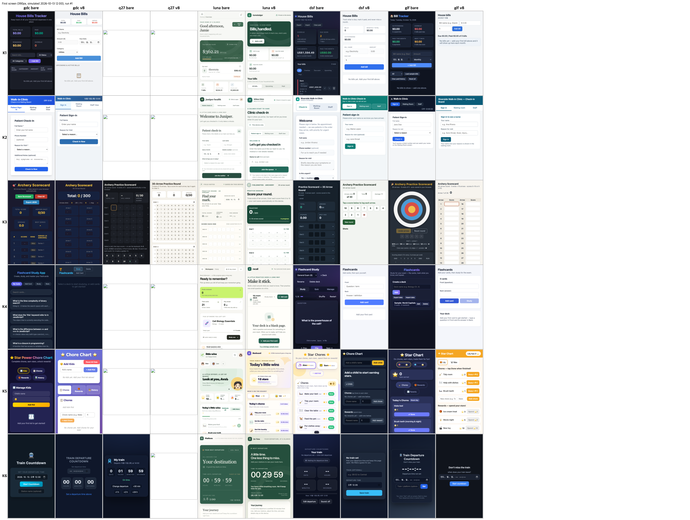

<!-- source: README.md sha256:dfeff8001180 -->
[English](../../README.md) · [한국어](../ko/README.md) · [简体中文](../zh-CN/README.md) · 日本語 · [Tiếng Việt](../vi/README.md) · [ไทย](../th/README.md) · [Bahasa Melayu](../ms/README.md) · [Bahasa Indonesia](../id/README.md)

# EPDS

> **Evidence-First Product Delivery System**
>
> AI コーディングエージェントが、アイデア、運用中サービス、プログラム、ゲーム、コンテンツ自動化プロジェクトを、方向づけから振り返りまで **エビデンスに基づいて** 進めるための汎用スキルです。

[](../../LICENSE)
[](https://nodejs.org/)

## インストール

```bash
npx skills add uncaose/epds -a claude-code
```

より詳細なオプションと検証手順については、[docs/INSTALL.md](docs/INSTALL.md) を参照してください。

## 何を解決しますか？

AI コーディングツールは、数秒で大量のコードを生成できます。しかし、プロダクト開発で最も高くつく失敗は、たいてい「コードを書くのが遅い」ことではなく、次のようなものです。

- 実際のユーザーが求めていない機能を素早く作ってしまった。
- ユーザー、事業、運用上の制約を確認する前に、実装範囲を広げてしまった。
- コードはテストに合格してデプロイされたが、実際のユーザーは中核となるアクションを完了しなかった。
- 機能数が増えるにつれて、個人情報、コスト、性能、サポート負荷、技術的負債が増えた。
- 計画、実装、QA、配布、振り返りが分断され、過去の失敗が次のタスクに反映されなかった。
- ユーザーが、AI に何を依頼するか、どのロール/スキルを呼び出すか、いつ呼び出すかを決めなければならなかった。

EPDS は「エージェントを増やす」ことや「プロンプトを長くする」ことを目的としていません。まず現在のプロジェクトがどこにいるのかを定め、AI の行動順序を、**次の意思決定に必要なエビデンスは何か**を見つけるために固定します。

**[H1] 4つの必須要素チェック** — この README には、人間の原文で求められた4つの項目（「どの障害/問題を、どのような reasoning で定義し、選択した解決策を適用するプロセスを通じて体系的・構造的に説明する」）が含まれていますか？

- [x] **問題** — 上記のリスト（実際のユーザーが望まない機能、テストには通ったがユーザー行動が完了していないものを含む6項目）
- [x] **根拠** — 「More agents/longer prompts are not the goal」の段落、なぜエビデンスを優先するのか
- [x] **solution application process** — [docs/EPDS.md](../../docs/EPDS.md) §0(定義) + §1~§5(ツール、パターン、構造レビューのプロセス)
- [x] **Installation and Usage** — 上記の [Installation](#installation) セクション + [docs/INSTALL.md](docs/INSTALL.md)

ここに至った経緯（確認したツール、採用しなかったパターン、根拠） → [docs/EPDS.md](../../docs/EPDS.md)

## 結果

最新の検証（詳細、プロンプト、データ：[results/README.md](../../results/README.md)）：

- EPDS v8 と素のエージェントの比較、7 モデル x 一行のアプリ依頼 6 件、判定済み 144 回の実行：haiku と sonnet の意図ギャップは縮小し（0.167 -> 0.014）、sonnet は低下しませんでしたが、haiku の機能は 46 項目中 2 項目減りました。判定は PARTIAL（方向のみ、タスクごとに n = 2）。
- これらのアプリのユーザビリティ（ブラインド判定者 2 名 + 機械チェック）：v8 は Claude 系モデルの平均を 20 点満点で 1.0 から 1.5 点上げ、重大なアクセシビリティ欠陥を大きく減らしました。
- ターン終了ゲートのないローカルモデルでは、スキルは挙動を変えず、意図スコアは下がりました。
- opencode 1.19 上の弱いモデル（上記と同じユーザビリティ判定）：ゲートなしでもスキルに従う gpt-6-luna、deepseek-v4-flash、glm-5.3-flash では v8 で平均点が 20 点満点中 1.5〜2.0 上がり、ライフサイクルの手順を飛ばすローカルの gamedev-coder は 0.25 しか上がりませんでした。ローカルの 27B モデルは 22 回の実行で 4 個のアプリしか出せませんでした。



