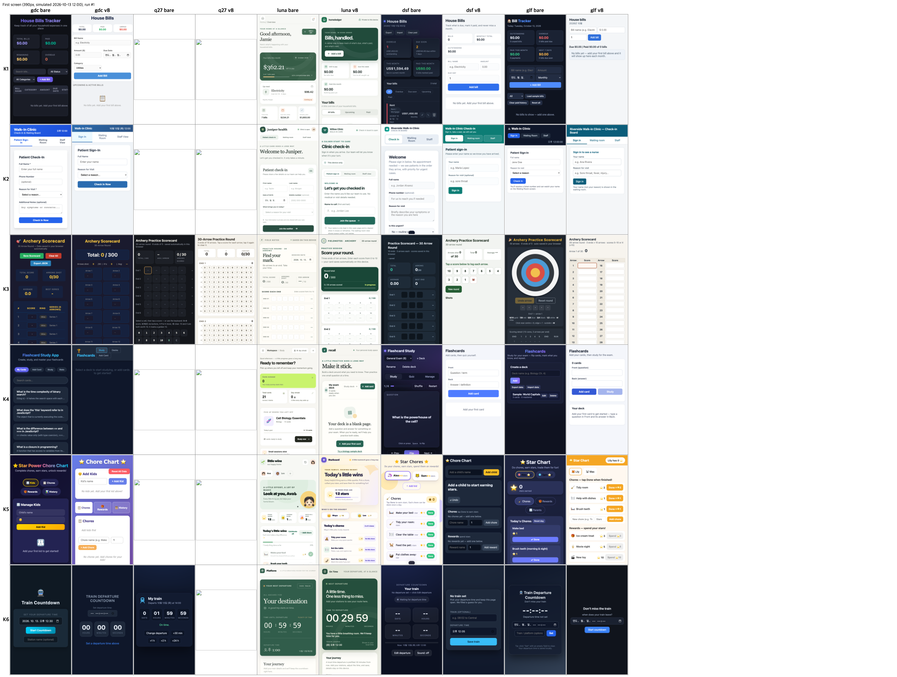

<!-- source: README.md sha256:a837cf2c4c24 -->
[English](../../README.md) · [한국어](../ko/README.md) · [简体中文](../zh-CN/README.md) · [日本語](../ja/README.md) · [Tiếng Việt](../vi/README.md) · [ไทย](../th/README.md) · Bahasa Melayu · [Bahasa Indonesia](../id/README.md)

# EPDS

> **Evidence-First Product Delivery System**
>
> Satu kemahiran umum yang membantu ejen pengekodan AI menjalankan projek idea, perkhidmatan berterusan, program, permainan, dan automasi kandungan daripada hala tuju hingga refleksi **berdasarkan bukti**.

[](../../LICENSE)
[](https://nodejs.org/)

## Pemasangan

```bash
npx skills add uncaose/epds -a claude-code
```

Untuk pilihan yang lebih terperinci dan prosedur pengesahan, sila rujuk [docs/INSTALL.md](docs/INSTALL.md).

## Apakah yang diselesaikannya?

Alat pengekodan AI boleh menghasilkan banyak kod dalam beberapa saat. Walau bagaimanapun, kegagalan paling mahal dalam pembangunan produk biasanya bukan "menulis kod lewat," tetapi perkara berikut.

- Mencipta ciri yang sebenarnya tidak diingini pengguna sebenar dengan cepat.
- Meluaskan skop pelaksanaan sebelum menyemak kekangan pengguna, perniagaan, dan operasi.
- Kod lulus ujian dan telah dikerahkan, tetapi pengguna sebenar tidak menyelesaikan tindakan teras.
- Apabila bilangan ciri meningkat, maklumat peribadi, kos, prestasi, beban sokongan, dan hutang teknikal meningkat.
- Perancangan, pelaksanaan, QA, pengedaran, dan refleksi dipisahkan, dan kegagalan terdahulu tidak dicerminkan dalam tugasan seterusnya.
- Pengguna perlu memutuskan apa yang hendak ditanya kepada AI, peranan/kemahiran apa yang hendak dipanggil, dan bila hendak memanggilnya.

EPDS bukan tentang "lebih banyak ejen" atau "prompt yang lebih panjang". Ia mula-mula menetapkan di mana projek semasa berada, dan menetapkan urutan tindakan AI untuk mengetahui **bukti apa yang diperlukan untuk keputusan seterusnya**.

**[H1] Semakan Empat Elemen Wajib** — Adakah README ini mengandungi empat perkara yang diminta oleh teks asal manusia ("Takrifkan halangan/masalah apa, melalui penaakulan apa, dan terangkan secara sistematik dan berstruktur melalui proses menerapkan penyelesaian yang dipilih")?

- [x] **Masalah** — Senarai di atas (6 item, termasuk ciri yang tidak diingini pengguna sebenar, dan tingkah laku pengguna yang tidak lengkap tetapi telah lulus ujian)
- [x] **Rasional** — Perenggan "More agents/longer prompts are not the goal", mengapa bukti diutamakan
- [x] **proses penerapan penyelesaian** — [docs/EPDS.md](../../docs/EPDS.md) §0(definition) + §1~§5(tool, pattern, and structure review process)
- [x] **Pemasangan dan Penggunaan** — Bahagian [Pemasangan](#pemasangan) di atas + [docs/INSTALL.md](docs/INSTALL.md)

Bagaimana saya sampai ke sini (alat yang dilihat, corak yang diketepikan, rasional) → [docs/EPDS.md](../../docs/EPDS.md)

## Keputusan

Pengesahan terkini (butiran, gesaan dan data: [results/README.md](../../results/README.md)):

- EPDS v8 berbanding ejen kosong, 7 model x 6 permintaan aplikasi satu baris, 144 larian yang dinilai: jurang niat antara haiku dan sonnet mengecil (0.167 -> 0.014) dan sonnet tidak menurun, tetapi fungsi haiku berkurang 2 daripada 46 item; keputusan PARTIAL (arah sahaja, n = 2 setiap tugasan).
- Kebolehgunaan aplikasi tersebut (2 penilai buta + semakan mesin): v8 menaikkan purata skor model keluarga Claude sebanyak 1.0 hingga 1.5 daripada 20 dan mengurangkan kecacatan kebolehcapaian yang serius dengan ketara.
- Tanpa get hujung giliran (model tempatan), kemahiran itu tidak mengubah tingkah laku dan skor niat menurun.
- Model lemah pada opencode 1.19 (penilai kebolehgunaan yang sama seperti di atas): v8 menaikkan skor purata sebanyak 1.5 hingga 2.0 daripada 20 bagi gpt-6-luna, deepseek-v4-flash dan glm-5.3-flash yang mengikuti skill tanpa get, dan hanya 0.25 bagi gamedev-coder tempatan yang melangkau langkah kitar hayat; model 27B tempatan hanya menghasilkan 4 aplikasi dalam 22 larian. Sel siling glm-5.3 premium (n=1) setanding dengan glm-5.3-flash pada skor niat (0.583 berbanding 0.625) tetapi kos bagi setiap mata niat kira-kira 8.5 kali ganda.



