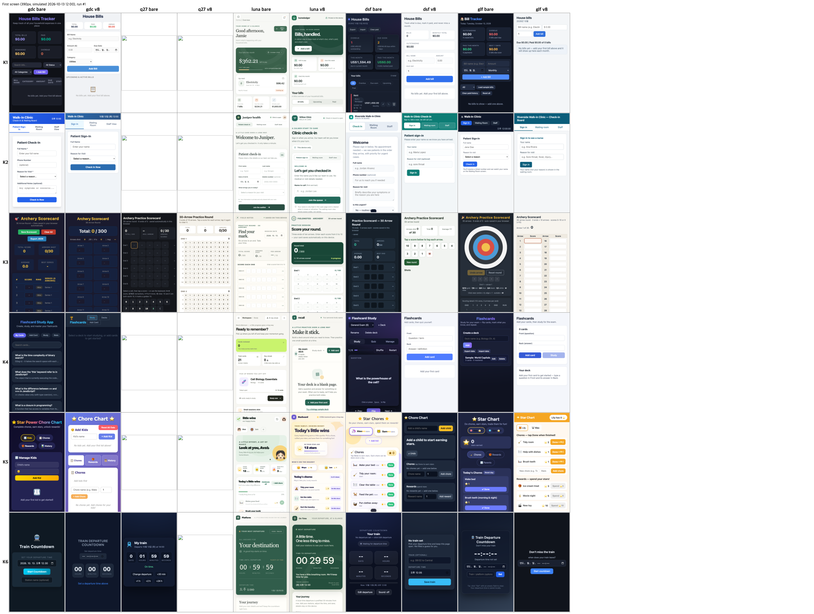

<!-- source: README.md sha256:a837cf2c4c24 -->
[English](../../README.md) · [한국어](../ko/README.md) · [简体中文](../zh-CN/README.md) · [日本語](../ja/README.md) · Tiếng Việt · [ไทย](../th/README.md) · [Bahasa Melayu](../ms/README.md) · [Bahasa Indonesia](../id/README.md)

# EPDS

> **Evidence-First Product Delivery System**
>
> Một kỹ năng tổng quát giúp các tác nhân lập trình AI thực hiện các dự án ý tưởng, dịch vụ đang vận hành, chương trình, trò chơi và tự động hóa nội dung từ định hướng đến phản tư **dựa trên bằng chứng**.

[](../../LICENSE)
[](https://nodejs.org/)

## Cài đặt

```bash
npx skills add uncaose/epds -a claude-code
```

Để xem các tùy chọn chi tiết hơn và quy trình xác minh, vui lòng tham khảo [docs/INSTALL.md](docs/INSTALL.md).

## Nó giải quyết vấn đề gì?

Công cụ lập trình AI có thể tạo ra rất nhiều mã trong vài giây. Tuy nhiên, những thất bại tốn kém nhất trong phát triển sản phẩm thường không phải là "viết mã muộn", mà là những điều sau.

- Nhanh chóng tạo ra một tính năng mà người dùng thật không muốn.
- Mở rộng phạm vi triển khai trước khi kiểm tra các ràng buộc về người dùng, kinh doanh và vận hành.
- Mã đã vượt qua kiểm thử và được triển khai, nhưng người dùng thật không hoàn thành các hành động cốt lõi.
- Khi số lượng tính năng tăng lên, thông tin cá nhân, chi phí, hiệu năng, gánh nặng hỗ trợ và nợ kỹ thuật cũng tăng theo.
- Lập kế hoạch, triển khai, QA, phân phối và phản tư bị tách rời, và các thất bại trước đó không được phản ánh vào tác vụ tiếp theo.
- Người dùng phải quyết định cần hỏi AI điều gì, gọi vai trò/kỹ năng nào, và gọi khi nào.

EPDS không phải là về "nhiều tác nhân hơn" hay "prompt dài hơn". Trước tiên, nó xác lập dự án hiện tại đang ở đâu, rồi cố định chuỗi hành động của AI để tìm ra **bằng chứng nào cần thiết cho quyết định tiếp theo**.

**[H1] Kiểm tra Bốn Yếu tố Bắt buộc** — README này có chứa bốn điều mà nguyên văn yêu cầu của con người đã nêu không ("Xác định trở ngại/vấn đề là gì, bằng lập luận nào, và giải thích một cách có hệ thống và có cấu trúc thông qua quá trình áp dụng giải pháp đã chọn")?

- [x] **Vấn đề** — Danh sách ở trên (6 mục, bao gồm các tính năng mà người dùng thật sự không muốn, và các hành vi người dùng chưa hoàn tất nhưng đã vượt qua kiểm thử)
- [x] **Cơ sở lập luận** — Đoạn "More agents/longer prompts are not the goal", vì sao ưu tiên bằng chứng
- [x] **quy trình áp dụng giải pháp** — [docs/EPDS.md](../../docs/EPDS.md) §0(định nghĩa) + §1~§5(quy trình xem xét công cụ, mẫu hình và cấu trúc)
- [x] **Cài đặt và Sử dụng** — Phần [Cài đặt](#cài-đặt) ở trên + [docs/INSTALL.md](docs/INSTALL.md)

Cách tôi đi đến đây (các công cụ đã xem, các mẫu hình đã loại bỏ, cơ sở lập luận) → [docs/EPDS.md](../../docs/EPDS.md)

## Kết quả

Kiểm chứng mới nhất (chi tiết, prompt và dữ liệu: [results/README.md](../../results/README.md)):

- EPDS v8 so với tác nhân trần, 7 mô hình x 6 yêu cầu ứng dụng một dòng, 144 lần chạy đã chấm: khoảng cách ý định giữa haiku và sonnet thu hẹp (0,167 -> 0,014) và sonnet không giảm, nhưng điểm chức năng của haiku giảm 2 trên 46 mục; kết luận PARTIAL (chỉ xem xu hướng, n = 2 cho mỗi tác vụ).
- Khả năng sử dụng của các ứng dụng đó (2 người chấm mù + kiểm tra máy): v8 nâng điểm trung bình của các mô hình họ Claude thêm 1,0 đến 1,5 trên 20 và giảm mạnh lỗi trợ năng nghiêm trọng.
- Với mô hình cục bộ không có cổng cuối lượt, kỹ năng không thay đổi hành vi và điểm ý định giảm.
- Mô hình yếu trên opencode 1.19 (cùng các bộ chấm khả năng sử dụng ở trên): v8 nâng điểm trung bình thêm 1,5 đến 2,0 trên 20 cho gpt-6-luna, deepseek-v4-flash và glm-5.3-flash (những mô hình làm theo skill mà không cần cổng chặn), nhưng chỉ thêm 0,25 cho gamedev-coder cục bộ vốn bỏ qua các bước vòng đời; mô hình 27B cục bộ chỉ giao 4 ứng dụng trong 22 lần chạy. Ô trần glm-5.3 cao cấp (n=1) cho điểm ý định tương đương glm-5.3-flash (0,583 so với 0,625) nhưng chi phí cho mỗi điểm ý định cao hơn khoảng 8,5 lần.



