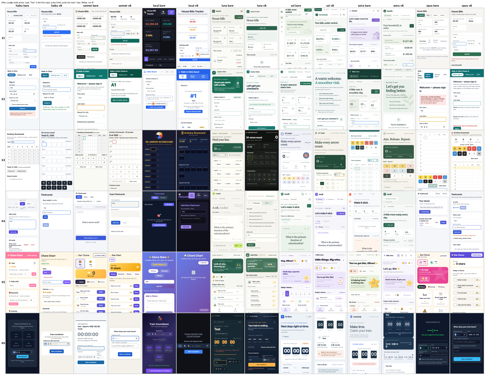

# EPDS v8 gate: results (2026-10-13/14)

Source: internal research R0383. EPDS under test: v8 = commit `e80e0b8`. Verdict by the pre-declared pass line: **PARTIAL**.

## Conclusion
- v8 shrank the sonnet-haiku intent gap (0.167 bare -> 0.014 v8) and did not hurt sonnet (0.806 -> 0.833), but haiku function with v8 is below bare (40/46 vs 42/46, a 2-item difference), so pass condition (c) fails.
- Intent rose with v8 for haiku, sonnet, sol, astra, opus and luna; it fell for the local model, which has no end-of-turn gate and never wrote `LIFECYCLE.md` (0/12).
- Where a runtime has an end-of-turn gate (Claude Code, Codex) LIFECYCLE.md compliance was 100% in v8 cells; only haiku, sonnet and luna were actually blocked by it (10 blocks), the rest wrote it unprompted.

## Method
| item | value |
|---|---|
| design | 6 one-line app requests (K1-K6), 2 arms (bare, v8), 144 judged runs, strictly serial, each run in a fresh empty folder |
| arms | `bare` = no skill, no hook. `v8` = EPDS v8 installed as a skill in the work folder plus the runtime's end-of-turn Stop hook where one exists (Claude Code, Codex). opencode has no documented blocking end-of-turn hook, so the local v8 cell runs with the skill only |
| models and runtimes | haiku `claude-haiku-5-5`, sonnet `claude-sonnet-5-5`, opus `claude-opus-5-5` (ceiling, n=6 per arm) via `claude -p`; luna `gpt-6-luna`, sol `gpt-6.1-sol`, astra `gpt-6-astra` (ceiling, n=6 per arm) via `codex exec -p <profile>`; local = LM Studio `gamedev-coder` (a local Qwen-3.6 35B-A3B class model) via `opencode run` inside a container |
| effort (actual) | medium everywhere: Claude `--effort medium` (the init event only reports that per-turn effort is active, so the flag is the evidence); Codex `-c model_reasoning_effort=medium` (header confirmed `reasoning effort: medium`); local = serving settings left untouched, no effort set by the request |
| n | 12 per cell (2 per task x 6 tasks); astra and opus 6 per cell |
| isolation | fresh empty git folder per run; Claude runs `--setting-sources project --strict-mcp-config`, WebFetch/WebSearch denied; Codex runs with a temporary `CODEX_HOME` holding only the profile and the auth link (no global instructions); local runs in a container with all capabilities dropped, 3 GB memory, 1800 s cap |
| judge | one fresh sonnet session per app, blind (scratch folder with `artifact.html` and the rubric only), same judge and prompt for every cell, never edited after the first run; judge crashes were re-run, not re-scored |
| rubrics | each task has 3-4 function items (F) and 5-6 intent items (I), sealed by SHA-256 before any run. Item text is not published here (it is a hidden test); hashes: see below |
| exceptions | 30 Claude runs that finished before the effort switch (CLI default effort, not verified medium) were moved aside and re-run at medium; the first 6 sol runs ran before the explicit `-c` override with the sol profile effort (medium) and are kept |

Task authors: K1-K3 written by Codex (gpt-5.5, medium, text only), K4-K6 by a fresh sonnet session. K1 and K4 are short ambiguous requests, K2 and K5 are hard, K6 is time-dependent.

### The six requests (verbatim)
| id | request |
|---|---|
| K1 | Help me keep up with house bills. |
| K2 | Please build a single-file check-in board for my small walk-in clinic with patient sign-in, a waiting-room view, and a staff view for calling people in. |
| K3 | Please make a tiny archery practice scorecard for a 30-arrow round that saves in my browser. |
| K4 | Make me a flashcard app to study for my exam. |
| K5 | Make me a chore chart app for my kids where they earn stars for chores and can spend them on rewards. |
| K6 | Make me a little page that counts down to my train departure so I don't miss it. |

Rubric SHA-256 (K1..K6): `5a9c44d092850056a9276529f39d6e5bd46bd112dd9c79526c9df73077234cfa`, `edc7a921b00a1541bb7cf8b962d604f33a1db731fb4a31097faf4f412e86af2f`, `2c9828f975854b7238cd6aeaa064a4984a714dcd678ba88ee4d898aa16bd7308`, `7c874979ab16927e761a59a649bccab2fa6e0f40dfad30b93d48f1d1bb1194da`, `03a6734c267ce43a22bb7c0c77b3d6d14d9a0a218384184c06bf8286935e1877`, `57e2394d16e133bfa3d2cca69e4716c7def4a54f80d770781d98bf8e79a0f75c`.

## Execution prompts (exact text sent to the model)
The prompt is `<prefix><request>` + blank line + `<harness note>`. Machine-specific paths are replaced by `<CHROME_PATH>` and `<PLAYWRIGHT_PATH>`; nothing else is changed.

**bare arm** (all models): no prefix.

**v8 arm, Claude models and local (haiku, sonnet, opus, local)**, prefix (the script uses this text for every model that is not luna, sol or astra, so the local run received it too):
```text
Use the epds skill (load it with the skill tool) for this task.

```

**v8 arm, Codex models (luna, sol, astra)**, prefix:
```text
Use the epds skill for this task.

```

**Harness note, Claude and Codex runs:**
```text
Harness note: save the final deliverable as index.html in the current working directory (the folder you were started in), a single self-contained file with no external resources. Verify it yourself before finishing: headless Chrome is at '<CHROME_PATH>' and playwright-core is at <PLAYWRIGHT_PATH> (e.g. const {chromium}=require('<PLAYWRIGHT_PATH>'); chromium.launch({executablePath:'<CHROME_PATH>', args:['--no-sandbox']}). No human is available to answer questions in this run.
```

**Harness note, local run (inside the container):**
```text
Harness note: save the final deliverable as /work/index.html (a single self-contained file, no external resources). Verify it yourself before finishing: headless Chromium is at /usr/bin/chromium and playwright-core is installed globally (NODE_PATH is set; use chromium.launch({executablePath:'/usr/bin/chromium', args:['--no-sandbox']})). No human is available to answer questions in this run.
```

**Judge prompt** (fresh sonnet session per app; `<DIR>` = scratch folder, `<CHROME_PATH>` and `<PLAYWRIGHT_PATH>` as above):
```text
You are an independent QA judge. In this folder: artifact.html (a web page someone built from a one-line request) and rubric.json (the request and the items to judge). You know nothing else about how the page was made. Do not read any other folder.

For EVERY item in rubric.json, decide pass or fail by actually using the page in a real browser, not by reading the code alone. Reading the source to find element names is fine, but the verdict must come from behaviour you observed.

Tooling: headless Chrome at '<CHROME_PATH>'; playwright-core at <PLAYWRIGHT_PATH>, e.g.
  const {chromium}=require('<PLAYWRIGHT_PATH>'); const b=await chromium.launch({executablePath:'<CHROME_PATH>',args:['--no-sandbox']});
Open the file with file://<DIR>/artifact.html . For anything that depends on time, use Playwright's clock: await page.clock.install({time:new Date('2026-10-13T12:00:00')}) BEFORE page.goto, then page.clock.runFor(ms) to advance (it fires timers and moves Date). Use a fresh browser context per scenario (localStorage starts empty). For reload tests reload the page inside the same context. Phone viewport = 390x844.

Rules: a pass needs the behaviour observed; if you could not exercise it, it is a fail with the reason. Judge what a reasonable requester of that one-line request would count as satisfied; do not demand more than the item says and do not give credit for things the item does not ask for. Be strict and literal about numbers in the item.

When finished, write verdict.json in this folder as exactly: {"items":[{"id":"F1","pass":true,"evidence":"one short sentence of what you observed"}, ...]} with one entry per rubric item (same ids). Then reply DONE.
```

## Results (model x arm)
Intent = mean share of intent items passed; function = pooled functional items passed. Turns for Codex = 1 (one `turn.completed`; tool calls are not counted as turns). Tokens are per-run means (input includes cache reads for Claude; Codex and local as reported by the runtime). Reasoning tokens are not broken out by any of the three runtimes in the recorded logs: "not recorded". Dollar cost is not reported for Codex and local runs. Gate-less local runs: gate "none".

| model | arm | n | intent | function (pooled) | turns | input tok | output tok | reasoning tok | total secs | first deliverable secs | LIFECYCLE.md present + check ok |
|---|---|---|---|---|---|---|---|---|---|---|---|
| haiku | bare | 12 | 0.639 | 42/46 (0.913) | 4.9 | 133k | 12.7k | not recorded | 63 | 41 (12/12 runs) | 0/12 |
| haiku | v8 | 12 | 0.819 | 40/46 (0.870) | 11.2 | 353k | 17.3k | not recorded | 232 | 82 (12/12 runs) | 12/12 |
| sonnet | bare | 12 | 0.806 | 44/46 (0.957) | 3.6 | 68k | 7.4k | not recorded | 49 | 37 (12/12 runs) | 0/12 |
| sonnet | v8 | 12 | 0.833 | 44/46 (0.957) | 7.3 | 155k | 6.7k | not recorded | 118 | 39 (12/12 runs) | 12/12 |
| local | bare | 12 | 0.528 | 36/46 (0.783) | 12.8 | 254k | 10.5k | not recorded | 194 | 90 (12/12 runs) | 0/12 |
| local | v8 | 12 | 0.403 | 33/46 (0.717) | 21.0 | 576k | 15.5k | not recorded | 358 | 65 (12/12 runs) | 0/12 |
| luna | bare | 12 | 0.514 | 41/46 (0.891) | 1.0 | 127k | 7.0k | not recorded | 115 | 90 (12/12 runs) | 0/12 |
| luna | v8 | 12 | 0.556 | 40/46 (0.870) | 1.0 | 351k | 10.2k | not recorded | 166 | 89 (12/12 runs) | 12/12 |
| sol | bare | 12 | 0.736 | 41/46 (0.891) | 1.0 | 174k | 10.8k | not recorded | 317 | 253 (12/12 runs) | 0/12 |
| sol | v8 | 12 | 0.847 | 46/46 (1.000) | 1.0 | 290k | 12.6k | not recorded | 430 | 331 (12/12 runs) | 12/12 |
| astra | bare | 6 | 0.778 | 21/23 (0.913) | 1.0 | 150k | 10.7k | not recorded | 340 | 282 (6/6 runs) | 0/6 |
| astra | v8 | 6 | 0.917 | 21/23 (0.913) | 1.0 | 258k | 10.6k | not recorded | 371 | 301 (6/6 runs) | 6/6 |
| opus | bare | 6 | 0.778 | 23/23 (1.000) | 7.5 | 188k | 14.3k | not recorded | 134 | 86 (6/6 runs) | 0/6 |
| opus | v8 | 6 | 0.917 | 23/23 (1.000) | 11.3 | 268k | 12.7k | not recorded | 180 | 84 (6/6 runs) | 6/6 |

Gap (sonnet minus model, intent), bare -> v8: haiku 0.167 -> 0.014 (shrinks), local 0.278 -> 0.431 (grows), luna 0.292 -> 0.278, sol 0.069 -> -0.014, astra 0.028 -> -0.083, opus 0.028 -> -0.083. Sol minus luna: 0.222 -> 0.292.

Pass line (fixed before any run): (a) haiku gap shrinks: **met** (0.014 vs 0.167). (b) sonnet v8 intent >= bare - 0.05: **met** (0.833 vs 0.806). (c) haiku function v8 >= bare: **not met** (0.870 vs 0.913). Result: PARTIAL.

LIFECYCLE compliance with a gate: Claude Code Stop hook 30/30 (blocks: haiku 1, sonnet 1, opus 0); Codex Stop hook 30/30 (blocks: luna 8, sol 0, astra 0); opencode (local) no gate, 0/12.

## Images
Contact sheets of all apps: tasks x model/arm, run #1, phone width 390 px, simulated clock 2026-10-13 12:00. Both are the original PNGs (1.9 MB each, no compression).

First screen:


After a generic judge-style action (type "Test" in the first input, press Enter, jump the clock one day):



| file | size | form |
|---|---|---|
| `contact-sheet-first.png` | 1,893,540 bytes | original |
| `contact-sheet-after.png` | 1,926,991 bytes | original |
| `apps.tar.gz` | 724,191 bytes | all 144 produced `index.html` apps as `apps/<model>-<task>-<arm>-<n>/index.html`, gzip |

## Limits
- n = 2 per task cell and 12 per model-arm cell: direction only, no significance claim.
- One judge model family (sonnet); sonnet judged the sonnet-authored tasks K4-K6, a possible same-family bias, reported and not corrected.
- The haiku function miss is 2 items out of 46, which is inside noise.
- The gate cap (3 blocks per session) and the Codex hook-trust bypass are part of the v8 arm. Local serving settings were not controlled (recorded untouched). Judging ran 4 sessions in parallel although runs were serial.
- 30 Claude runs were re-run after the effort change (originals kept in the internal archive); haiku K6 v8 #2 hit the 1500 s timeout and was re-run once under the retry rule.
- Raw transcripts and per-run metrics stay in the internal research archive (R0383); only the apps are bundled here.
