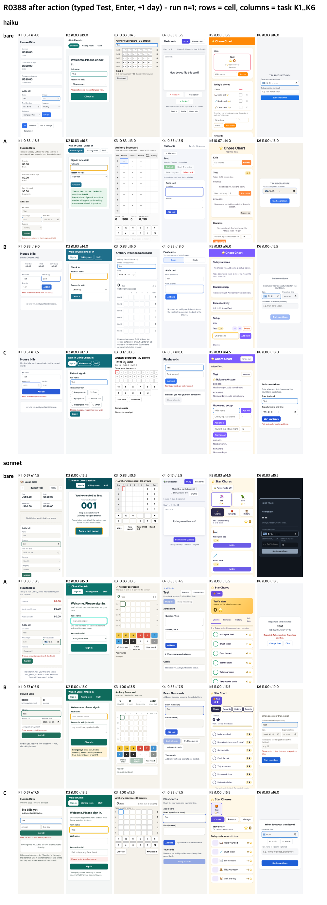
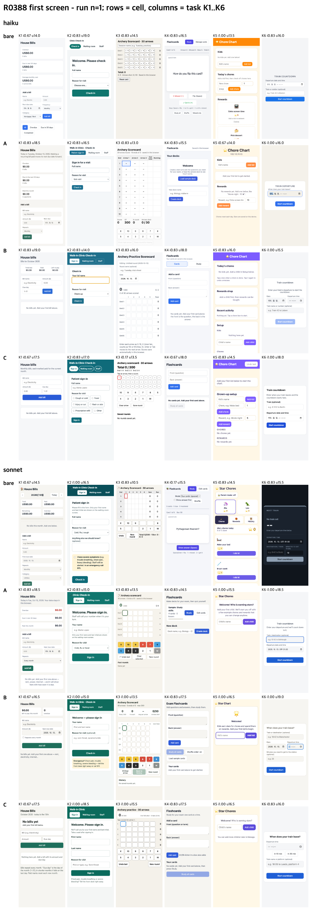

# Where the EPDS gain comes from (R0388)

## Conclusion
- Most of the gain over a bare agent comes from what the model does **before it writes the app** (take stock, write 3 to 7 observable checks). Checks alone (cell A) raised intent by +0.09 and usability by +0.81 of 20 over bare; adding the 5-row lifecycle table before building (cell B) raised them by +0.13 and +0.98.
- The full skill with execution, fix loop and Stop gate (cell C) added usability (+0.6 over A) but no intent, at about 3x the total time of A or B (258 s vs 79 to 81 s) and about 2x the tokens.
- Neither pre-declared verdict line fired, both narrowly, so the declared outcome is "the table is paperwork (record default off is possible)". Direction only: n = 12 per cell and model, and the usability noise floor from the previous run is about +-0.75 per run.

## Method
Same six one-line requests, hidden rubric and judges as the v8 gate run ([2026-10-13-v8-gate](../2026-10-13-v8-gate/RESULTS.md)) and the usability run ([2026-10-14-usability](../2026-10-14-usability/RESULTS.md)).

| cell | what the model gets |
|---|---|
| bare | no skill |
| A | v9.1 SKILL.md steps 1 to 4 only (take stock, questions never block, write 3 to 7 observable checks one line each, build) plus one `Security:` line in the final report. No execution step, no fix loop, no lifecycle table, no gate. |
| B | A plus the 5-row lifecycle table written before building (last column may stay empty). No checker, no gate. |
| C | EPDS v9.1 in full (6ef2f06) with the Stop gate. |

- Models: claude-haiku-5-5 and claude-sonnet-5-5, reasoning effort medium on every run (`--effort medium`).
- 4 cells x 6 tasks x 2 models x 2 repeats = 96 runs, strictly serial. Variants A and B were cut from canon text by deletion only; no new instruction and no model-tier branch.
- Judges: intent and function from the hidden rubric (fresh judge per app, blind ids); usability /20 = mean of two blind judge lanes plus machine checks, after one typed action and a one-day clock jump.
- Verdict lines were written before any run: (1) A within -0.05 intent and -0.5 usability of C means "checks before writing are enough"; (2) B at least +0.05 intent over A means "the table is a thinking tool"; otherwise "the table is paperwork".

## Exact prompts
Skill cells get the prefix "Use the epds skill (load it with the skill tool) for this task." before the request.

| task | request |
|---|---|
| K1 | Help me keep up with house bills. |
| K2 | Please build a single-file check-in board for my small walk-in clinic with patient sign-in, a waiting-room view, and a staff view for calling people in. |
| K3 | Please make a tiny archery practice scorecard for a 30-arrow round that saves in my browser. |
| K4 | Make me a flashcard app to study for my exam. |
| K5 | Make me a chore chart app for my kids where they earn stars for chores and can spend them on rewards. |
| K6 | Make me a little page that counts down to my train departure so I don't miss it. |

## Results (n = 12 per row)

| model | cell | intent | function /4 | usability /20 | turns | tokens in / out / cache read | $ per run | total s | first result s |
|---|---|---|---|---|---|---|---|---|---|
| haiku | bare | 0.750 | 3.83 | 15.62 | 6.6 | 173k / 13.2k / 152k | 0.012 | 74 | 41 |
| haiku | A | 0.833 | 3.75 | 16.12 | 10.0 | 270k / 16.9k / 244k | 0.016 | 100 | 52 |
| haiku | B | 0.847 | 3.83 | 16.38 | 11.9 | 332k / 19.2k / 302k | 0.019 | 102 | 61 |
| haiku | C | 0.694 | 3.25 | 16.79 | 15.9 | 581k / 24.4k / 540k | 0.029 | 337 | 85 |
| sonnet | bare | 0.750 | 3.75 | 15.08 | 4.2 | 96k / 7.3k / 82k | 0.135 | 57 | 37 |
| sonnet | A | 0.847 | 3.58 | 16.21 | 5.8 | 103k / 7.3k / 89k | 0.138 | 57 | 39 |
| sonnet | B | 0.917 | 3.83 | 16.29 | 6.6 | 117k / 7.2k / 102k | 0.141 | 60 | 44 |
| sonnet | C | 0.889 | 3.75 | 16.75 | 11.9 | 304k / 9.0k / 283k | 0.201 | 179 | 39 |

Both models together: intent bare 0.750 / A 0.840 / B 0.882 / C 0.792; usability 15.35 / 16.17 / 16.33 / 16.77.

| verdict line | measured | result |
|---|---|---|
| 1. A within -0.05 intent and -0.5 usability of C | intent +0.049, usability -0.60 | not met (misses by 0.10 usability) |
| 2. B >= A + 0.05 intent | +0.042 (sonnet +0.069, haiku +0.014) | not met |

## Limits
- Machine load average rose from 2.61 to 10.1 during the runs, so the seconds columns may be inflated; tokens, cost and turns are not affected.
- Cell C's low intent is driven by haiku (0.694); the cause was not diagnosed.
- In every C run (24 of 24) the gate's lifecycle check ended at exit 1, so the gate never passed.
- Small single-file apps only; this does not generalize to work inside a real repository.
