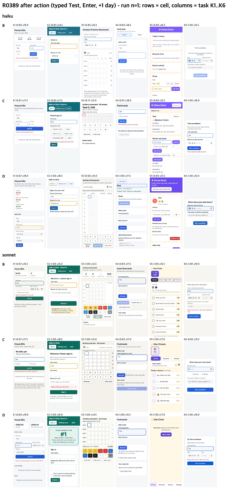

# One usability line instead of the full loop? (R0389)

## Conclusion
- Adding one general line to the medium level ("Use an established component library or design system for the target platform, and run that platform's official accessibility check once before finishing.") did **not** reach the usability of the high level: -0.40 of 20 against a pre-declared limit of -0.25. Verdict: keep the current three levels.
- The line was not really testable here: the run frame asks for one self-contained file with no external resources, so 0 of 24 runs used a library, and no automated accessibility checker was available, so 0 of 24 ran one. It still cut small tap targets from 5.7 to 1.6 per app.
- With both usability judges on Claude models, the high level is only +0.27 of 20 above medium (16.75 vs 16.48), inside the per-run noise of about +-0.75, at about 3x the time.

## Method
Same six requests, rubric and run frame as [2026-10-15-gain-source](../2026-10-15-gain-source/RESULTS.md). New cell D = medium-level text plus the line above (no library or tool named). haiku and sonnet, reasoning effort medium, 6 tasks x 2 repeats = 24 runs. Usability lanes: sonnet and opus (both effort medium, blind); cells B and C from the previous run were re-judged by the new opus lane so all three cells share the same judges. Verdict line fixed before the runs: D usability >= C - 0.25 and D intent >= B - 0.05.

## Results (both models, n = 24 per cell)

| cell | intent | usability /20 (sonnet / opus / mean) | axe serious+critical | small targets | tokens in / out | $ per run | total s | first result s |
|---|---|---|---|---|---|---|---|---|
| B medium | 0.882 | 16.04 / 16.92 / 16.48 | 0.33 | 5.71 | 224k / 13.2k | 0.080 | 81 | 52 |
| C high | 0.792 | 16.50 / 17.00 / 16.75 | 0.25 | 4.33 | 442k / 16.7k | 0.115 | 258 | 62 |
| D medium + line | 0.896 | 16.12 / 16.58 / 16.35 | 1.25 | 1.62 | 238k / 13.0k | 0.079 | 95 | 52 |

By model: sonnet D - C = -0.08 (passes), haiku -0.71 (fails); haiku D apps had more serious accessibility defects (2.50 vs 0.67 for B).

## Limits
- Single-file, no-external-resource apps: the library half of the line could not apply, and no checker was on the path.
- Load average about 13.6 during the runs: seconds columns are inflated; tokens, cost and turns are not.
- The opus lane scores about 0.6 higher than the sonnet lane; compare cells only within the same lanes.
