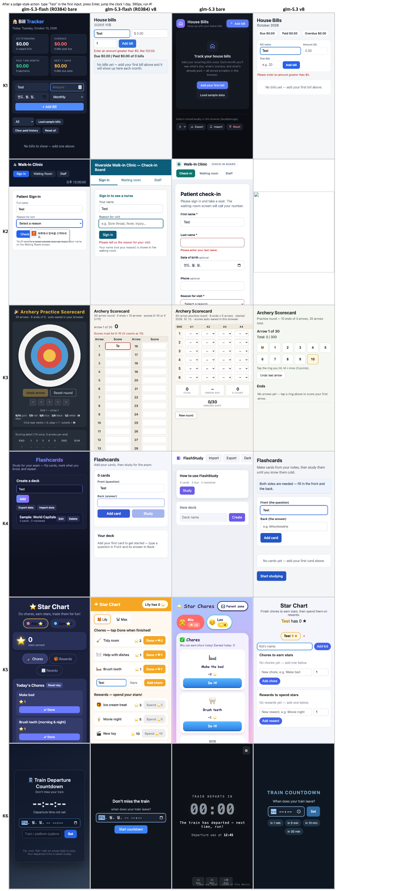
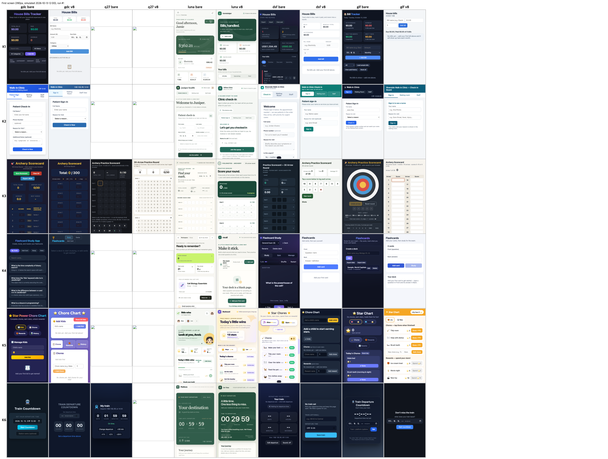
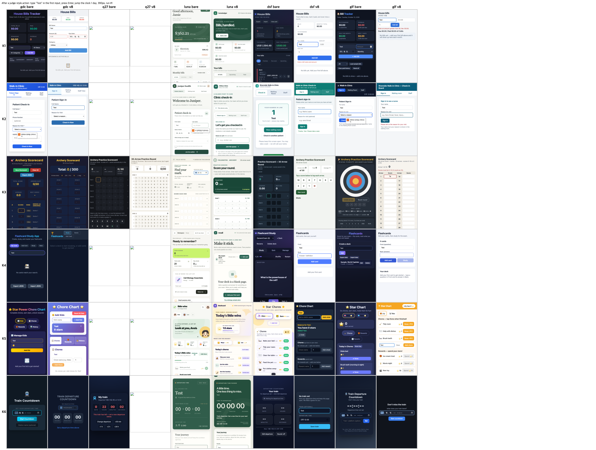

# EPDS v8 on weak models under opencode 1.19, with usability (2026-10-14/15)

Source: internal research R0384 (runs) and R0385 stage 2 (usability judging). EPDS under test: v8 skill (same text as the [v8 gate run](../2026-10-13-v8-gate/RESULTS.md)), installed as a skill in the work folder; no end-of-turn gate or plugin in any opencode cell. Verdict by the pre-declared lines: **PARTIAL** (118 of 120 runs executed; the 27B local server stopped answering). H-ver (opencode 1.19 lifts local-model compliance): **not supported**. H-model (luna follows the lifecycle more than the local model on the same runtime): **not supported by the declared end-state metric, supported by the in-run transcript measure** (post hoc, labelled).

## Conclusion
- The runtime version is not the cause: the local `gamedev-coder` wrote and checked `LIFECYCLE.md` in 1 of 12 v8 runs on opencode 1.19 (0 of 12 on 1.18.35); intent 0.417 vs 0.403, function 32/46 vs 33/46, usability 14.29 vs 14.33 of 20. The model decides.
- Three models follow the skill without any gate: `gpt-6-luna` wrote `LIFECYCLE.md` first in 11 of 12 v8 runs (but deleted it as cleanup in 10, so the end-state metric shows 2 of 12), `deepseek-v4-flash` 12 of 12, `glm-5.3-flash` 10 of 12. Their v8 apps are more usable: +1.54, +2.04 and +1.54 points of 20 (mean of two blind judges), the same size as the Claude family with a gate (+1.0 to +1.5); the local `gamedev-coder` gains +0.25 (noise).
- `Qwen3.8-27B` (local) is not usable in this loop: 19 of 22 runs hit the 1800 s cap, 4 apps in 22 runs, and after one run the server stopped answering chat requests.

## Method
| item | value |
|---|---|
| design | 5 models x {bare, v8} x the six requests K1-K6 of the v8 gate run x n=2 = 120 planned runs, strictly serial, each in a fresh empty folder; 118 executed |
| runtime | opencode 1.19.0 in a container image built on the earlier 1.18.35 image (`npm i -g opencode-ai@1.19.0`); the 1.18.35 numbers are the v8 gate run's local cell, not re-run |
| models | `gamedev-coder` = local Qwen-3.6 35B-A3B class model in LM Studio (no effort control); `q27` = local Qwen3.8-27B via `mlx_lm.server`; `luna` = `gpt-6-luna` (Responses API); `dsf` = `deepseek-v4-flash`; `glf` = `glm-5.3-flash` (the last three through an OpenCode Go proxy) |
| arms | `bare` = no skill. `v8` = skill copied into the work folder + one sentence asking to load it; no gate |
| judging, build | R0383 function/intent judge unchanged: one fresh sonnet session per run, blind, same sealed rubrics; runs without a deliverable score 0 |
| judging, usability | the [usability evaluation](../2026-10-14-usability/RESULTS.md) re-used unchanged: rubric sealed with SHA-256 `b83e5f8001d962c978adb391dbdb5b710645b26d856fcd4128e229cbb53911bf`, two blind lanes (GPT sol and Claude sonnet-5-5, both effort medium), machine checks; the 100 apps that exist were judged, the 18 runs without an app score 0 in the "all" columns |
| local isolation | before each local run: GPU utilisation under 20 % and no heavy foreign process; local blocks first, cloud blocks after |

### Effort (set, and evidence that it was delivered)
| cell | setting | evidence |
|---|---|---|
| gamedev-coder | not applicable (no effort control; none sent, as in the v8 gate run) | n/a |
| q27 | `reasoning_effort: "medium"` via the opencode model option | request body captured at a mock endpoint: `{"reasoning_effort":"medium","max_tokens":32000}`; direct probe: reasoning length none 448 / medium 1458 / high 805 characters (n = 1, not monotonic) |
| luna | Responses API `reasoning {effort: medium, summary: auto}` | body captured at the same mock; the proxy forwards the body unchanged except the model name |
| dsf, glf | `reasoning_effort: "medium"` on chat completions | body captured; both answered with reasoning tokens |
Usability judges: GPT lane `-c model_reasoning_effort=medium`, Claude lane `--effort medium`.

## Execution prompt (exact text sent to every opencode model)
The prompt is `<prefix><request>` + blank line + harness note; the same note went to every cell (the cloud models too). The six requests are listed in the [v8 gate results](../2026-10-13-v8-gate/RESULTS.md#method).

**bare arm**: no prefix.

**v8 arm**, prefix:
```text
Use the epds skill (load it with the skill tool) for this task.

```

**Harness note:**
```text
Harness note: save the final deliverable as /work/index.html (a single self-contained file, no external resources). Verify it yourself before finishing: headless Chromium is at /usr/bin/chromium and playwright-core is installed globally (NODE_PATH is set; use chromium.launch({executablePath:'/usr/bin/chromium', args:['--no-sandbox']})). No human is available to answer questions in this run.
```
Build judge and usability judge prompts: see the [v8 gate results](../2026-10-13-v8-gate/RESULTS.md#execution-prompts-exact-text-sent-to-the-model) and the [usability results](../2026-10-14-usability/RESULTS.md#execution-prompt-judge-both-lanes).

## Results (model x arm)
Intent = mean share of intent items passed; function = pooled functional items; tokens = per-run means (input includes cache reads; opencode reports `output` and `reasoning` separately); time = mean/median seconds; LIFECYCLE = `LIFECYCLE.md` present at the end with the check script exiting 0, and in parentheses the transcript measure (runs in which the check script passed at some point during the run, opencode only, post hoc). Usability = mean of two blind judges, of 20, zeros included for runs with no app (GPT / Claude / mean). For the Claude Code and Codex rows (v8 gate run, with gate) usability is the mean over their 12 apps.

| model | arm | runs | intent | function | turns | tokens in/out/reasoning | total s | first deliverable s | LIFECYCLE | usability GPT / Claude / mean |
|---|---|---|---|---|---|---|---|---|---|---|
| gamedev-coder | bare | 12 | 0.486 | 39/46 | 9.7 | 156k/9.2k/0.6k | 166/162 | 101/111 | 0/12 | 14.75 / 13.33 / 14.04 |
| gamedev-coder | v8 | 12 | 0.417 | 32/46 | 19.4 | 452k/13.9k/2.9k | 291/242 | 81/86 | 1/12 (1/12) | 14.75 / 13.83 / 14.29 |
| Qwen3.8-27B | bare | 11 | 0.167 | 11/43 | 4.2 | 76k/15.8k/0.0k | 1648/1800 | 890/816 (3 runs) | 0/11 | 3.91 / 3.73 / 3.82 (3 apps: 14.00) |
| Qwen3.8-27B | v8 | 11 | 0.045 | 4/43 | 5.8 | 98k/14.1k/0.0k | 1801/1801 | 1641 (1 run) | 7/11 (6/11) | 1.36 / 1.36 / 1.36 (1 app: 15.00) |
| gpt-6-luna | bare | 12 | 0.458 | 39/46 | 12.8 | 210k/13.3k/1.6k | 167/144 | 91/99 | 0/12 | 15.17 / 13.83 / 14.50 |
| gpt-6-luna | v8 | 12 | 0.694 | 39/46 | 20.1 | 466k/12.3k/7.1k | 241/226 | 118/118 | 2/12 (11/12) | 16.75 / 15.33 / 16.04 |
| deepseek-v4-flash | bare | 12 | 0.583 | 38/46 | 12.5 | 206k/9.9k/1.4k | 126/98 | 63/55 | 0/12 | 14.25 / 14.17 / 14.21 |
| deepseek-v4-flash | v8 | 12 | 0.778 | 35/46 | 14.5 | 299k/7.4k/8.4k | 240/170 | 109/112 | 12/12 (12/12) | 16.25 / 16.25 / 16.25 |
| glm-5.3-flash | bare | 12 | 0.611 | 36/46 | 13.2 | 193k/7.7k/1.1k | 150/125 | 45/47 | 0/12 | 15.08 / 13.08 / 14.08 |
| glm-5.3-flash | v8 | 12 | 0.625 | 36/46 | 20.1 | 324k/6.3k/2.6k | 199/174 | 69/62 | 10/12 (11/12) | 16.50 / 14.75 / 15.62 |
| *gamedev-coder, opencode 1.18.35 (v8 gate run)* | bare | 12 | 0.528 | 36/46 | 12.8 | 254k/10.5k/0.9k | 194/133 | 90/88 | 0/12 | 14.33 / 13.50 / 13.92 |
| *gamedev-coder, opencode 1.18.35 (v8 gate run)* | v8 | 12 | 0.403 | 33/46 | 21.0 | 576k/15.5k/5.4k | 358/197 | 65/66 | 0/12 | 15.17 / 13.50 / 14.33 |
| *gpt-6-luna, Codex with Stop hook (v8 gate run)* | bare | 12 | 0.514 | 41/46 | 4.8 tool calls | 127k/7.0k/0.3k | 115/124 | 90/84 | 0/12 | 15.75 / 13.58 / 14.67 |
| *gpt-6-luna, Codex with Stop hook (v8 gate run)* | v8 | 12 | 0.556 | 40/46 | 11.1 tool calls | 351k/10.2k/1.7k | 166/135 | 89/77 | 12/12 | 14.83 / 13.92 / 14.38 |
| *haiku, Claude Code with Stop hook (v8 gate run)* | bare | 12 | 0.639 | 42/46 | 3.9 | 133k/12.7k/not recorded | 63/60 | 41/42 | 0/12 | 15.58 / 13.75 / 14.67 |
| *haiku, Claude Code with Stop hook (v8 gate run)* | v8 | 12 | 0.819 | 40/46 | 14.1 | 353k/17.3k/not recorded | 232/114 | 82/78 | 12/12 | 16.17 / 16.17 / 16.17 |
| *sonnet, Claude Code with Stop hook (v8 gate run)* | bare | 12 | 0.806 | 44/46 | 2.6 | 68k/7.4k/not recorded | 49/54 | 37/41 | 0/12 | 15.83 / 14.58 / 15.21 |
| *sonnet, Claude Code with Stop hook (v8 gate run)* | v8 | 12 | 0.833 | 44/46 | 6.2 | 155k/6.7k/not recorded | 118/55 | 39/38 | 12/12 | 16.50 / 16.00 / 16.25 |

Italic rows come from the v8 gate run and its [usability evaluation](../2026-10-14-usability/RESULTS.md) and are repeated for comparison only. Qwen3.8-27B first-deliverable time covers the 3 + 1 runs that produced an app. Length stops (output cut by the token limit) were 0 in every cell.

### v8 minus bare, usability (mean of two lanes, of 20)
| model | with zeros | apps only |
|---|---|---|
| gamedev-coder | +0.25 | +0.25 |
| gpt-6-luna | +1.54 | +1.54 |
| deepseek-v4-flash | +2.04 | +2.04 |
| glm-5.3-flash | +1.54 | +1.54 |
| Qwen3.8-27B | -2.45 | +1.00 (1 vs 3 apps, not comparable) |

Machine checks follow the same direction: v8 cut axe serious+critical findings per app from 23.5 to 11.4 (luna), 6.6 to 1.1 (deepseek-v4-flash), 4.3 to 1.4 (glm-5.3-flash), and only from 11.8 to 10.8 for the local gamedev-coder. Judge agreement over the 100 apps: Pearson 0.52 (v8 gate apps: 0.48), exact per-item agreement 67 %; usability correlates with intent (r 0.51) and hardly with function (r 0.10), as before.

### First action after the skill loaded (v8 arm)
| model | first write |
|---|---|
| gamedev-coder | `index.html` 7, a bash heredoc 4, `LIFECYCLE.md` 1 (of 12) |
| gpt-6-luna | `LIFECYCLE.md` 11, `index.html` 1 |
| deepseek-v4-flash | `LIFECYCLE.md` 7, a probe or read first 5 |
| glm-5.3-flash | `LIFECYCLE.md` 7, other 5 |
| Qwen3.8-27B | `LIFECYCLE.md` 6, bash/other 3 (of 9 with a write) |
With bare prompts every model that produced something wrote `index.html` first.

## Ceiling cell: glm-5.3 (R0386, n=1)
Does the premium sibling of `glm-5.3-flash` buy more? 12 runs (glm-5.3 x {bare, v8} x K1-K6, n=1), same opencode 1.19 image, prompts and blind R0383 judge as above; flash rows are the n=2 cells from the table above. Method difference: the shared proxy silently rewrites `glm-5.3` to another model, so a private proxy copy with that rewrite emptied was used; all 175 upstream requests carried `effort=medium` and `model=glm-5.3`. Verdict: the premium buys no visible quality (pre-declared H-ceiling, needs +0.15 intent: **not supported**; H-cost >= 5x per intent point: supported, 8.5x; H-life 5 of 6: supported).

| model | arm | runs | intent | function | turns | tokens in/out/reasoning | total s | first deliverable s | LIFECYCLE | est. $/run | $ per intent point |
|---|---|---|---|---|---|---|---|---|---|---|---|
| glm-5.3-flash (n=2) | bare | 12 | 0.611 | 36/46 | 13.2 | 193k/7.7k/1.1k | 150/125 | 45/47 | 0/12 | $0.033 | $0.055 |
| glm-5.3-flash (n=2) | v8 | 12 | 0.625 | 36/46 | 20.1 | 324k/6.3k/2.6k | 199/174 | 69/62 | 10/12 | $0.053 | $0.085 |
| glm-5.3 (n=1) | bare | 6 | 0.556 | 20/23 | 15.8 | 488k/13.8k/12.0k | 730/664 | 266/250 | 0/6 | $0.797 | $1.435 |
| glm-5.3 (n=1) | v8 | 6 | 0.583 | 18/23 | 9.8 | 211k/13.3k/15.0k | 854/825 | 539/343 | 5/6 | $0.420 | $0.720 |

Cost is an upper bound: all input tokens (cache reads included) at the input price, output plus reasoning at the output price. Intent steps are 1/6 per run, so differences under about 0.15 are noise.

Limits of this cell: n = 1 per task; the K2 v8 run produced no deliverable (4 turns, reasoning only) and scores 0, so there is no K2 v8 app; the K3 v8 run ended with SIGTERM at 1150 s (cause unknown) but had a deliverable and `LIFECYCLE.md`, kept as observed; the K4 bare run hit the 1800 s cap with a deliverable present from 175 s; 2 of 175 upstream requests returned 502; one build-judge family (sonnet). Usability was not judged for this cell.

Run 1 of every glm-5.3 cell after the generic action (type "Test", Enter, clock +1 day); empty cell = no deliverable. The PNG is the original (about 0.8 MB).



## Images
Contact sheets of run #1 of every cell (5 models x {bare, v8} x K1-K6, phone width, simulated clock 2026-10-13 12:00); empty cells are runs without a deliverable. Both original PNGs (about 1.2 MB each, no compression).

First screen:



After a generic judge-style action (type "Test" in the first input, press Enter, jump the clock one day):



| file | size | form |
|---|---|---|
| `contact-sheet-first.png` | 1,273,208 bytes | original |
| `contact-sheet-after.png` | 1,255,241 bytes | original |
| `apps.tar.gz` | 454,944 bytes | the 100 produced `index.html` apps as `apps/<model>-<task>-<arm>-<n>/index.html`, gzip (model codes: gdc = gamedev-coder, q27 = Qwen3.8-27B, luna, dsf = deepseek-v4-flash, glf = glm-5.3-flash) |

## Cost of the usability judging (stage 2)
| item | value |
|---|---|
| GPT sol lane | 1,247,027 tokens in total (input/output/reasoning split not recorded), 1,582 judge-seconds (15.8 s per app, 4 in parallel) |
| Claude sonnet lane | 4,001,605 tokens in total including cache reads (split not recorded), 927 judge-seconds (9.3 s per app) |
| capture + machine checks | 100 apps in 195 s, serial |

## Limits
- **Qwen3.8-27B**: 22 of 24 planned runs executed; 19 hit the 1800 s cap; after one v8 run the server stopped answering chat completions (GPU idle, model list still answered), so two K6 runs were never executed and its numbers are a lower bound from a degraded server. Restarting it was out of scope (serving issue, not a prompt issue).
- **luna cleanup**: luna wrote the lifecycle file and ran the check in 11 of 12 v8 runs, then deleted `LIFECYCLE.md` and the check file as cleanup in 10; the declared end-state metric (2 of 12) under-counts it. The transcript measure is post hoc and labelled so; the pre-declared verdict is reported as declared.
- **Local runs**: GPU idleness was checked only at the start of each local run; concurrent use by other sessions during a run cannot be excluded.
- **No gate**: opencode has no end-of-turn gate in these cells, so compliance here is instruction-only; the Codex and Claude Code compliance in the italic rows is gate-assisted.
- n = 2 per task cell and 12 per model-arm cell (3 and 1 for Qwen3.8-27B apps): direction only; differences under about 1 point of 20 are within noise. One build-judge family (sonnet) and two usability lanes, both LLMs, no human sample.
- Usability judges see two screenshots and DOM text, not the live app; the "after" action is a fixed script. Scores of 0 for missing apps are a convention, not a usability judgment: read "apps only" for quality and "with zeros" for reliability.
- Raw runs, transcripts and per-item judge scores stay in the internal research archive (R0384, R0385).
