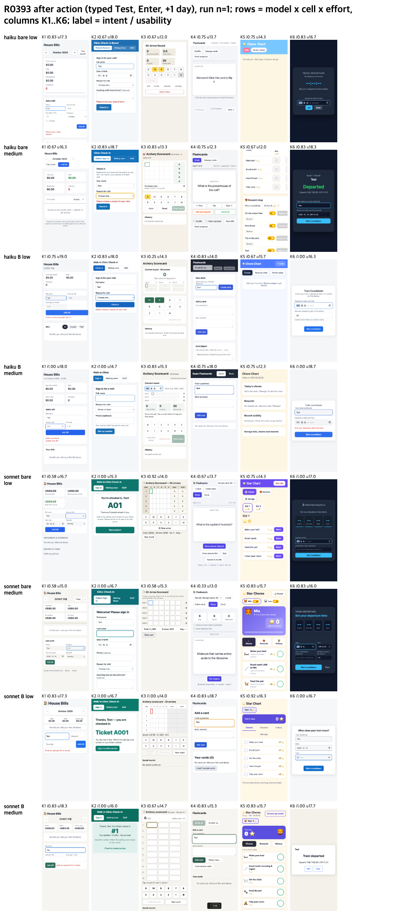

# Reasoning effort low vs medium (R0393)

## Conclusion
- Low reasoning effort cost 25% less and finished about a third faster than medium, with no drop in usability (+0.24 of 20) and a small drop in intent (-0.034). By the line fixed before the runs this means "low is enough" overall, but only as a direction: every 95% CI crosses a threshold.
- The intent drop is on haiku (-0.078 pooled, -0.115 in cell B with the skill); sonnet is flat (+0.010). So low looks safe for sonnet and doubtful for haiku with EPDS.
- No default change is made from this run alone (n = 12 per model and cell for low).

## Method
Same six requests, frame, hidden rubric and judges as [2026-10-16-limits-resolved](../2026-10-16-limits-resolved/RESULTS.md). Only low was run new: cells bare and B (medium level) x haiku and sonnet x K1 to K6 x 2 repeats = 48 runs with `--effort low`, strictly serial, a run starts only when the 1-minute load is 8 or lower. Medium = the 96 earlier runs of the same cells (n = 24 per model and cell). Usability = mean of three judge lanes (two Claude, one Codex), intent = mean of two lanes.

Line fixed before the runs: low intent >= medium intent - 0.05 and low usability >= medium usability - 0.5 means "low is enough"; otherwise "keep medium".

## Results (difference = low minus medium)

| scope | n low / medium | intent low / medium | usability /20 low / medium | verdict |
|---|---|---|---|---|
| haiku bare | 12 / 24 | 0.694 / 0.736 | 15.33 / 15.14 | low enough |
| haiku B | 12 / 24 | 0.743 / 0.858 | 16.42 / 16.19 | keep medium |
| sonnet bare | 12 / 24 | 0.764 / 0.753 | 15.31 / 15.15 | low enough |
| sonnet B | 12 / 24 | 0.882 / 0.872 | 16.28 / 15.89 | low enough |
| all | 48 / 96 | 0.771 / 0.805 (-0.034, CI -0.093 to +0.024) | 15.83 / 15.59 (+0.24, CI -0.41 to +0.87) | low enough, direction only |

| per run, low vs medium | $ | output tokens | total time | turns |
|---|---|---|---|---|
| haiku | -36% | -39% | -37% | -20% |
| sonnet | -24% | -29% | -26% | -15% |
| all | -25% | -36% | -33% | -19% |

Judge agreement: usability ICC(2,1) 0.647; intent Claude lane 0.767 vs Codex lane 0.774.

## Limits
- n = 12 per model and cell for low; no row is firm.
- Low and medium were judged in different sessions; medium times were measured under other machine load, so the time column is not clean (tokens and cost are).
- The CLI's init event has no effort field; the evidence is `--effort low` in the saved argv of all 48 runs plus the 36% drop in output tokens.
- Six small single-file apps only.
