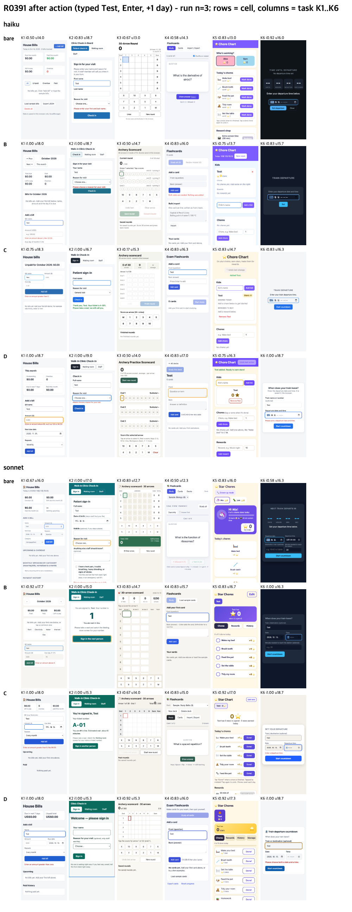
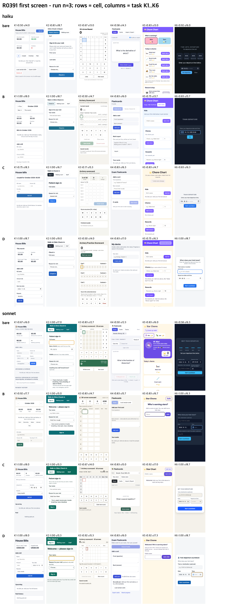

# The usability line, with the open limits closed (R0391)

## Conclusion
- Doubling the sample (n = 48 per cell, 192 runs) did not change the verdict: cell D used a UI library in 4% of runs (95% CI 0 to 10%) and ran an accessibility check in 50% (CI 40 to 60%; haiku 83%, sonnet 17%). The pre-declared "applied" line (both at least 50%) is still not met, so the usability comparison does not count as a test of the line. Verdict: keep the current three levels; nothing supports retiring high.
- The judges are trustworthy enough: a third usability lane from a different vendor (Codex) and a second intent lane were added for all 192 runs. Usability agreement ICC(2,1) = 0.71, intent Cohen's kappa = 0.79. No judge favoured apps from its own model family.
- The haiku drop in intent at the high level reproduced again at n = 24: 0.726 at high vs 0.858 at medium (bare 0.736).

## Method
Same frame as [2026-10-16-ui-principle-proper](../2026-10-16-ui-principle-proper/RESULTS.md) (same six requests, CDN allowed, checker on the PATH, cells bare / B medium / C high / D = B plus the usability line). Added before any new run, in a committed addendum:

| open limit | what was done |
|---|---|
| judge script version | the machine-transcript parser got an 8-fixture selftest; all 96 earlier extracts re-derived byte-identical |
| both usability judges were Claude | third lane = Codex (`-p sol`, reasoning effort medium, read-only), same rubric, captures and blind ids |
| 16 intent calls had been re-run | second intent lane (Codex) on all 192 runs; the re-run calls differ by +0.031 mean, in line with the rest |
| no agreement measure | ICC(2,1), Spearman, Cohen's kappa |
| n = 12 per cell, noise about +-0.75 | repeats 3 and 4 (96 new runs, strictly serial, load at start 2 to 5); 95% bootstrap CIs, 10000 resamples |

## Results (n = 24 per model and cell; usability = mean of 3 lanes, intent = mean of 2 lanes)

| cell | haiku usability /20 | haiku intent | haiku axe serious+critical | sonnet usability /20 | sonnet intent | sonnet axe serious+critical |
|---|---|---|---|---|---|---|
| bare | 15.14 | 0.736 | 5.67 | 15.15 | 0.753 | 5.04 |
| B (medium) | 16.19 | 0.858 | 1.92 | 15.89 | 0.872 | 0.21 |
| C (high) | 16.54 | 0.726 | 0.58 | 16.24 | 0.882 | 0.46 |
| D (B + line) | 16.99 | 0.809 | 0.00 | 16.35 | 0.889 | 0.00 |

| line (both models, n = 48) | measured [95% CI] | result |
|---|---|---|
| L2 library use >= 50% | 4% [0, 10] | not met (firm) |
| L2 check run >= 50% | 50% [40, 60] | on the line |
| L1 usability D >= C - 0.25 | +0.28 [-0.36, +0.92] | met by point, direction only |
| L1 intent D >= B - 0.05 | -0.016 [-0.073, +0.042] | met by point, direction only |
| outcome | L2 not met, so L1 is void | keep current |

Haiku cost per run: bare $0.013, B $0.017, C $0.022, D $0.018; total time 67 / 101 / 190 / 110 s.

## Limits
- The usability difference D minus C still has a CI of about +-0.65 at n = 48, so any replace-or-keep call on usability is direction only.
- All judges are LLMs scoring 390 x 844 captures of six small single-file apps; this does not generalize to work inside a real repository.
- The Codex judge lane ran Chrome without its sandbox (Chrome aborts under it); exposure is the same as the Claude lanes.
