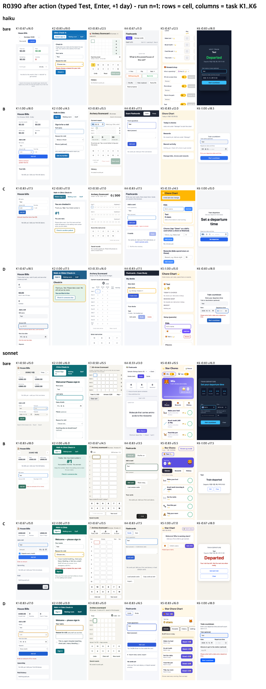
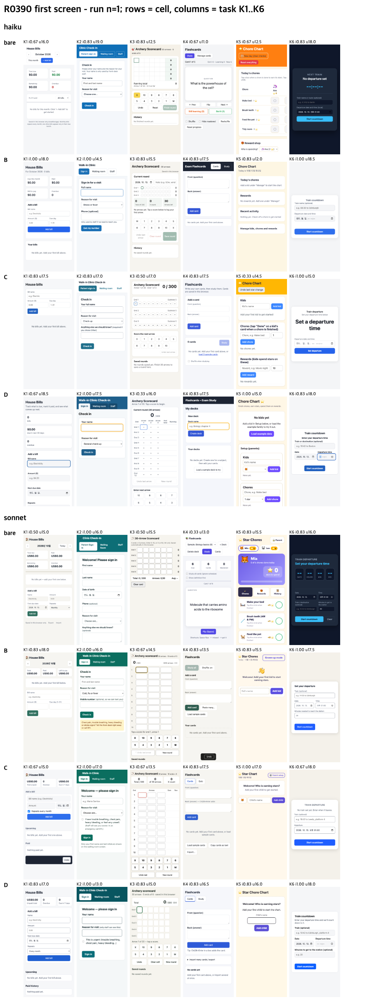

# The usability line, re-tested where it can apply (R0390)

## Conclusion
- The models still did not apply the line, even when they could: with CDN libraries allowed and an accessibility checker on the PATH, cell D used a UI library in 1 of 24 runs and ran an accessibility check in 12 of 24 (haiku 10 of 12, sonnet 2 of 12). The pre-declared "applied" line (both at least 50%) was not met, so the usability comparison does not count as a test of the line. Verdict: keep the current three levels; nothing here supports retiring high.
- Where haiku did check, it fixed: serious and critical axe findings fell from 1.62 per app (medium) to 0.00, contrast failures from 0.21 to 0.00. Small tap targets rose from 2.38 to 4.38.
- The haiku drop in intent at the high level reproduced (0.708 vs 0.875 at medium). Cause: at high, haiku builds to its own 8 to 11 declared checks, so apps shrink (9.3 KB vs 15.3 KB) and behaviour outside those checks is dropped.

## Method
Same six requests, hidden rubric and judges as [2026-10-15-gain-source](../2026-10-15-gain-source/RESULTS.md) and [2026-10-15-ui-principle](../2026-10-15-ui-principle/RESULTS.md). Changes for every cell: the deliverable is still one `index.html`, but CDN CSS and JS are allowed; an `a11y-check` command (axe-core wrapper, exit 1 on serious or critical findings) is on the PATH but not named in any prompt; a run starts only when the 1-minute load is 8 or lower (93 of 96 runs waited 0 s).

| cell | what the model gets |
|---|---|
| bare | no skill |
| B | medium level (checks before writing plus the lifecycle table) |
| C | high level (EPDS v10, `EPDS_LEVEL=high`, full loop and Stop gate) |
| D | B plus "Use an established component library or design system for the target platform, and run that platform's official accessibility check once before finishing." |

- haiku and sonnet, reasoning effort medium, 4 cells x 6 tasks x 2 models x 2 repeats = 96 runs, strictly serial.
- Lines fixed before the runs: L1 = D usability >= C - 0.25 and D intent >= B - 0.05; L2 = D library use >= 50% and check run >= 50%. If L2 fails, L1 is void.

## Results (both models, n = 24 per cell)

| cell | intent | usability /20 | axe serious+critical | targets < 44 px | contrast fails | tokens in / out | $ per run | total s | first result s |
|---|---|---|---|---|---|---|---|---|---|
| bare | 0.736 | 14.85 | 6.29 | 10.88 | 3.62 | 131k / 11.0k | 0.073 | 60 | 41 |
| B | 0.882 | 16.17 | 1.62 | 2.38 | 0.21 | 213k / 10.8k | 0.075 | 77 | 46 |
| C | 0.785 | 16.19 | 0.46 | 2.33 | 0.46 | 285k / 13.5k | 0.097 | 178 | 53 |
| D | 0.861 | 16.31 | 0.00 | 4.38 | 0.00 | 253k / 12.6k | 0.084 | 94 | 48 |

| line | all | haiku | sonnet |
|---|---|---|---|
| L1 usability D - C (>= -0.25) | +0.12 | +0.62 | -0.38 |
| L1 intent D - B (>= -0.05) | -0.021 | -0.056 | +0.014 |
| L2 library used (>= 50%) | 4% | 8% | 0% |
| L2 check ran (>= 50%) | 50% | 83% | 17% |
| result | L2 not met, L1 void | not met | not met |

Every check that ran was the model's own axe-core loaded from a CDN; none used the PATH command. Cells bare, B and C used no library and ran no check (0 of 72).

## Limits
- n = 12 per model and cell; per-run usability noise is about +-0.75 of 20.
- Both usability lanes are Claude models (sonnet and opus), and the sonnet lane also judged sonnet-built apps.
- 16 intent-judge calls hit an account rate limit and were re-run after the reset (not re-scored).
- Small single-file apps only.
