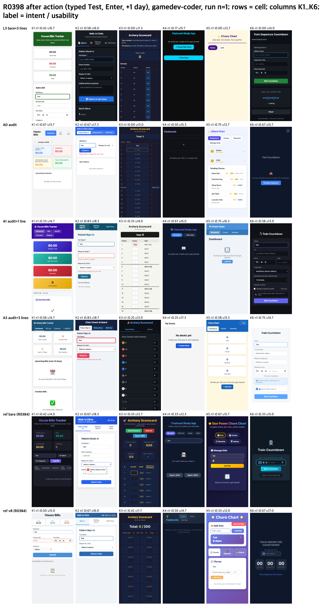

# Local model: three observable checks vs a design audit (R0398)

## Conclusion
- On the local gamedev-coder model (OpenCode), none of the four cells beat bare intent by the pre-declared +0.10. Only one result is firm: three observable checks in the prompt (L3) lowered intent (-0.146) even though the model obeyed them (checker run 12 of 12, accessibility defects near zero).
- A design audit before building (A0, Codex reviewer) scored highest on intent and function by point estimate, at 2 to 3 times the tokens and time of bare; the gain is direction only.
- Rules placed in the audited design document were mostly dropped at build time (checker run 2 of 12 in A3), unlike rules placed in the prompt.

## Method
Same six requests and judges as [2026-10-17-usability-prompt-gate](../2026-10-17-usability-prompt-gate/RESULTS.md); local gamedev-coder under OpenCode, 12 runs per cell. Bare and EPDS v8 reference runs from [2026-10-15-weak-opencode](../2026-10-15-weak-opencode/RESULTS.md) re-judged in the same pass.

| cell | what the model gets |
|---|---|
| L3 | bare plus three observable checks (44 px targets, 4.5:1 contrast, run `a11y-check index.html` until 0 serious or critical) |
| A0 | model writes a design, a Codex reviewer audits it (blocking/optional), the model applies blocking items once, then builds |
| A1 | A0 plus the one-line usability principle in the design |
| A3 | A0 plus the three checks in the design |

## Results (n = 12 per cell)

| cell | intent | function /4 | usability /20 | axe serious+critical | checker run | tokens in / out | total s |
|---|---|---|---|---|---|---|---|
| L3 | 0.340 | 2.08 | 14.53 | 0.00 | 12/12 | 334k / 8.4k | 223 |
| A0 | 0.556 | 3.21 | 14.94 | 4.64 | 0/12 | 977k / 18.4k | 459 |
| A1 | 0.521 | 2.92 | 15.50 | 4.17 | 0/12 | 546k / 16.0k | 362 |
| A3 | 0.507 | 2.62 | 14.92 | 1.00 | 2/12 | 740k / 19.7k | 470 |
| bare (re-judged) | 0.451 | 3.08 | 14.28 | 11.75 | n/a | 156k / 9.2k | 166 |
| EPDS v8 (re-judged) | 0.458 | 2.71 | 14.03 | 11.73 | n/a | 452k / 13.9k | 291 |

## Limits
- n = 12 per cell; judge drift is larger than most cell differences (the same bare apps re-judged at 0.451 vs 0.486 before).
- No design-only cell without the audit, so the A0 gain cannot be credited to the audit itself.
- "Addressed" audit items are the model's own report (110 of 112), not checked per item.
