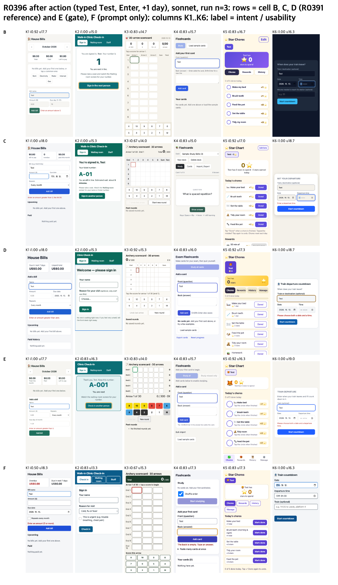

# Making the usability line stick: prompt vs machine gate (R0396)

## Conclusion
- The earlier usability line was ignored because it was vague, not because models cannot follow it. Written as three observable checks with the checker's name (cell F), sonnet ran the accessibility check in 24 of 24 runs and ended with 0 serious or critical findings in 24 of 24 (the old line: 4 of 24).
- A machine Stop gate (cell E) gets the same 24 of 24, at about $0.018 more per run and 1.4 more turns. The prompt alone is enough; the gate is not needed.
- Both reach high-level usability by point estimate (E +0.11, F +0.21 of 20 vs high) with medium-level intent, and F costs less than high ($0.134 vs $0.167). Usability differences are direction only (95% CI about +-0.9). Sonnet only.

## Method
Same six requests, frame (CDN allowed, checker on the PATH), judges and blind ids as [2026-10-16-limits-resolved](../2026-10-16-limits-resolved/RESULTS.md). Sonnet, reasoning effort medium, 24 runs per new cell, strictly serial, plugins isolated.

| cell | what the model gets |
|---|---|
| B | medium level |
| C | high level (full loop and Stop gate) |
| D | B plus the old one-line usability principle (no tool name) |
| E | B plus a Stop gate that runs the usability checker (axe serious+critical 0, no tap target under 44 px, no contrast failure) and returns failures, up to 3 times |
| F | B plus three observable checks in the before-writing list: every button and input at least 44 px high, body contrast at least 4.5:1, and "before finishing run `a11y-check index.html`; fix and re-run until it reports no serious or critical findings" |

## Results (sonnet, n = 24 per cell; B, C, D reused from earlier runs)

| cell | intent | usability /20 | axe serious+critical | targets < 44 px | $ per run | total s |
|---|---|---|---|---|---|---|
| B | 0.872 | 15.89 | 0.21 | 4.08 | 0.137 | 61 |
| C | 0.882 | 16.24 | 0.46 | 3.50 | 0.167 | 82 |
| D | 0.889 | 16.35 | 0.00 | 4.00 | 0.149 | 74 |
| E | 0.878 | 16.35 | 0.00 | 0.00 | 0.151 | 74 |
| F | 0.854 | 16.44 | 0.00 | 0.17 | 0.134 | 69 |

Gate blocks in E: 0 in 8 runs, 1 in 16 runs, never 2 or 3.

## Limits
- Sonnet only; haiku was not part of the verdict.
- Usability differences are direction only; E and F were judged in a later sweep than B to D (lane agreement ICC 0.65).
- E's final axe 0 is partly by construction (the gate and the metric share the checker).
